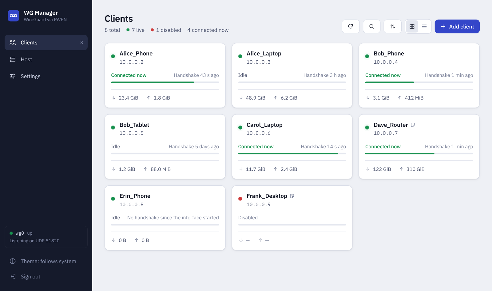

<a id="readme-top"></a>

<div align="center">
  <a href="https://elmedico27.github.io/wgmanager/">
    
  </a>

  <h3 align="center">WG Manager</h3>

  <p align="center">
    A web GUI for managing the clients of a PiVPN WireGuard server.
    <br />
    <br />
    <a href="https://elmedico27.github.io/wgmanager/">Documentation</a>
    &middot;
    <a href="https://wgmdemo.pages.dev">View Demo</a>
    &middot;
    <a href="https://github.com/elmedico27/wgmanager/issues/new?labels=bug">Report Bug</a>
    &middot;
    <a href="https://github.com/elmedico27/wgmanager/issues/new?labels=enhancement">Request Feature</a>
  </p>
</div>

<details>
  <summary>Table of Contents</summary>
  <ol>
    <li>
      <a href="#about-the-project">About The Project</a>
      <ul>
        <li><a href="built-with">Built With</a></li>
      </ul>
    </li>
    <li>
      <a href="#getting-started">Getting Started</a>
      <ul>
        <li><a href="#prerequisites">Prerequisites</a></li>
        <li><a href="#installation">Installation</a></li>
        <li><a href="#update">Update</a></li>
        <li><a href="#uninstall">Uninstall</a></li>
      </ul>
    </li>
    <li><a href="#usage">Usage</a></li>
    <li><a href="#contributing">Contributing</a></li>
    <li><a href="#license">License</a></li>
    <li><a href="#acknowledgments">Acknowledgments</a></li>
  </ol>
</details>

## About The Project

<picture>
  <source media="(prefers-color-scheme: dark)" srcset="docs/public/screenshot-dark.png">
  
</picture>

Add, delete, enable, and disable your WireGuard clients, all without opening a terminal.  Show a client's QR code, download its config file, and see who is connected.

WG Manager is a **Docker web app** and a **small helper** on the server that runs PiVPN commands under a limited-purpose user.  See more about [how it works](https://elmedico27.github.io/wgmanager/guide/how-it-works).

### Built With

[](https://svelte.dev) [](https://vite.dev) [](https://tailwindcss.com) [](https://nodejs.org) [](https://www.python.org) [](https://hub.docker.com/r/elmedico27/wgmanager)

## Getting Started

> [!WARNING]
> Don't install, update or restart WG Manager while connected through the VPN it manages. Connect from your local network instead.

### Prerequisites

- A 64-bit (amd64 or arm64) Debian or Debian-based server, with all of the following:
  - [PiVPN](https://pivpn.io), set up for **WireGuard**
  - [Docker](https://docs.docker.com/engine/install/debian/)
  - Python 3 (`sudo apt install python3`)
  - SSH enabled

### Installation

1. **Download the setup files** into a new folder:

   ```sh
   mkdir -p ~/wgmanager && cd ~/wgmanager
   curl -fsSLO https://raw.githubusercontent.com/elmedico27/wgmanager/master/compose.yaml
   curl -fsSLo .env https://raw.githubusercontent.com/elmedico27/wgmanager/master/.env.example
   ```

2. **Set your SSH port.**  
   - If it isn't `22`, set `SSH_PORT` in `.env`. To check it, run `sudo sshd -T | grep -i '^port '`.  See [Configuration](https://elmedico27.github.io/wgmanager/guide/configuration) for all `.env` settings.

3. **Start WG Manager** and find the one-time setup code in its log:

   ```sh
   docker compose up -d
   docker logs wgmanager
   ```

4. **Choose your admin password.** 
   - In a browser, open `http://<server-address>:7501`, enter the setup code, and choose a password of at least 12 characters.

5. **Install the helper.** 
   - The next screen shows an install command with this app's key filled in. Click **Copy**, run it on the server, and type `y` at `Proceed? [y/N]`. Its last line is the server's fingerprint.

6. **Confirm your server.** 
   - Click **Test connection**. If the fingerprint matches the installer's last line, click **It matches**. If it doesn't, click **It doesn't match** and stop.

The web interface will load and automatically populate your clients. Each step is explained in full in the [getting started](https://elmedico27.github.io/wgmanager/guide/getting-started) guide.

### Update

> [!NOTE]
> If you pinned `WGM_VERSION` in `.env` to a fixed version, change it first.

1. In your project folder, run:

   ```sh
   docker compose pull && docker compose up -d
   ```
    
2. Sign in. If a **Helper update available** notice appears, click **Show update command** and run it on the server, then click **Check again**. No notice means the helper is already up to date.

### Uninstall

Your WireGuard server, PiVPN and clients are left as they are.

```sh
cd ~/wgmanager
sudo python3 /usr/local/lib/wgmanager/wgmanager-host uninstall
sudo rm -rf /usr/local/lib/wgmanager
docker compose down -v
```

The `-v` flag deletes the app's data (password, SSH key, confirmed server identity). The config backups in `/var/backups/wgmanager` are kept; add `--purge` to `uninstall` to delete them too.

## Usage

Open `http://<server-address>:7501` and sign in with your admin password.

**If a change fails,** WG Manager shows a warning on every page until you acknowledge it, with a link to [Recovering from a failed change](https://elmedico27.github.io/wgmanager/guide/recovery). For anything else, start with [Troubleshooting](https://elmedico27.github.io/wgmanager/guide/troubleshooting).

## Contributing

Bug reports and feature ideas are welcome in [Issues](https://github.com/elmedico27/wgmanager/issues). Bugs are fixed as time allows; feature ideas are considered for the roadmap but may not be built. How to build, run and test the code is described in [Contributing](https://elmedico27.github.io/wgmanager/development/). Changes are listed in the [changelog](CHANGELOG.md).

## License

Distributed under the GPL-3.0 license. See [LICENSE](LICENSE).

## Acknowledgments

- [pivpn-web](https://github.com/WeeJeWel/pivpn-web) by Emile Nijssen.  WG Manager began as a fork of this project, but evolved enough that none of the upstream code remains.
- [PiVPN](https://pivpn.io), which does the actual work on the server.
- [Best-README-Template](https://github.com/othneildrew/Best-README-Template), which this README follows.

<p align="right">(<a href="#readme-top">back to top</a>)</p>
