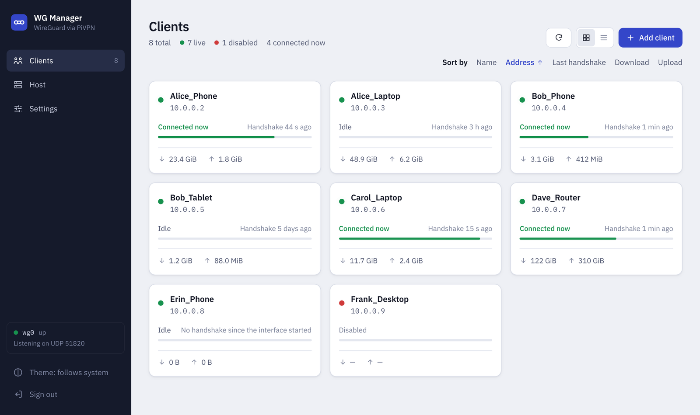

<a id="readme-top"></a>

<div align="center">
  <a href="https://elmedico27.github.io/wgmanager/">
    
  </a>

  <h3 align="center">WG Manager</h3>

  <p align="center">
    A web page for managing the clients of a PiVPN WireGuard server.
    <br />
    <a href="https://elmedico27.github.io/wgmanager/"><strong>Explore the docs »</strong></a>
    <br />
    <br />
    <a href="https://wgmanager-demo.pages.dev">View Demo</a>
    &middot;
    <a href="https://github.com/elmedico27/wgmanager/issues/new?labels=bug">Report Bug</a>
    &middot;
    <a href="https://github.com/elmedico27/wgmanager/issues/new?labels=enhancement">Request Feature</a>
  </p>
</div>

<details>
  <summary>Table of Contents</summary>
  <ol>
    <li>
      <a href="#about-the-project">About The Project</a>
      <ul>
        <li><a href="#built-with">Built With</a></li>
      </ul>
    </li>
    <li>
      <a href="#getting-started">Getting Started</a>
      <ul>
        <li><a href="#prerequisites">Prerequisites</a></li>
        <li><a href="#installation">Installation</a></li>
        <li><a href="#update">Update</a></li>
        <li><a href="#uninstall">Uninstall</a></li>
      </ul>
    </li>
    <li><a href="#usage">Usage</a></li>
    <li><a href="#contributing">Contributing</a></li>
    <li><a href="#license">License</a></li>
    <li><a href="#acknowledgments">Acknowledgments</a></li>
  </ol>
</details>

## About The Project

<picture>
  <source media="(prefers-color-scheme: dark)" srcset="docs/screenshot-dark.png">
  
</picture>

From a browser you can add, enable, disable and delete your WireGuard clients, show a client's QR code, download its config file, and see who is connected.

- **The web app** runs in Docker. It is the page you open in your browser.
- **A small helper** on your server is the only part that touches WireGuard, and it does so through PiVPN's own tools.
- **An SSH key** connects the two. It can start the helper and nothing else.

PiVPN stays in charge of your server, and the `pivpn` command keeps working alongside WG Manager. [How it works](https://elmedico27.github.io/wgmanager/guide/how-it-works) has the details.

> [!TIP]
> **[Try the live demo](https://wgmanager-demo.pages.dev).** It runs entirely in your browser with sample data, and any password signs you in.

### Built With

- [Svelte](https://svelte.dev), [Vite](https://vite.dev) and [Tailwind CSS](https://tailwindcss.com) for the web UI
- [Node.js](https://nodejs.org) for the backend
- [Python](https://www.python.org) for the server helper (standard library only)
- [Docker](https://www.docker.com) for packaging
- [VitePress](https://vitepress.dev) for the documentation

<p align="right">(<a href="#readme-top">back to top</a>)</p>

## Getting Started

### Prerequisites

- A 64-bit (amd64 or arm64) Debian or Debian-based server, such as Raspberry Pi OS (64-bit), with [PiVPN](https://pivpn.io) set up for **WireGuard**.
- Docker with Compose v2, plus `python3`, `sudo` and an OpenSSH server.
- WG Manager runs on **the same machine as PiVPN**.

Run every command below on the PiVPN server unless a step says otherwise. If a `docker` command fails with "permission denied", run it again with `sudo`.

> [!WARNING]
> Don't install, update or restart WG Manager while connected through the VPN it manages. Connect from your local network instead.

### Installation

1. **Download the setup files** into a new folder:

   ```sh
   mkdir -p ~/wgmanager && cd ~/wgmanager
   curl -fsSLO https://raw.githubusercontent.com/elmedico27/wgmanager/master/compose.yaml
   curl -fsSLO https://raw.githubusercontent.com/elmedico27/wgmanager/master/.env.example
   mv .env.example .env
   ```

2. **Set your SSH port.** If it isn't `22`, set `SSH_PORT` in `.env`. To check it, run `sudo sshd -T | grep -i '^port '`.

3. **Start WG Manager** and find the one-time setup code in its log:

   ```sh
   docker compose up -d
   docker logs wgmanager
   ```

4. **Choose your admin password.** In a browser, open `http://<server-address>:7501`, enter the setup code, and choose a password of at least 12 characters.

5. **Install the helper.** The next screen shows an install command with this app's key filled in. Click **Copy**, run it on the server, and type `y` at `Proceed? [y/N]`. Its last line is the server's fingerprint.

6. **Confirm your server.** Click **Test connection**. If the fingerprint matches the installer's last line, click **It matches**. If it doesn't, click **It doesn't match** and stop.

Your clients now appear. Each step is explained in full in [Getting started](https://elmedico27.github.io/wgmanager/guide/getting-started).

### Update

1. In the folder that contains `compose.yaml`:

   ```sh
   docker compose pull && docker compose up -d
   ```

   If you pinned `WGM_VERSION` in `.env` to a fixed version, change it first.

2. Sign in, open **Settings › App key**, and run the install command on the server again.

### Uninstall

Your WireGuard server, PiVPN and clients are left as they are.

```sh
sudo python3 /usr/local/lib/wgmanager/wgmanager-host uninstall
sudo rm -rf /usr/local/lib/wgmanager
docker compose down -v
```

Run the last command in the app's folder. `-v` also deletes the app's data (password, SSH key, confirmed server identity). The config backups in `/var/backups/wgmanager` are kept; add `--purge` to `uninstall` to delete them too.

<p align="right">(<a href="#readme-top">back to top</a>)</p>

## Usage

Open `http://<server-address>:7501` and sign in. [Web interface](https://elmedico27.github.io/wgmanager/guide/web-interface) describes each page, and [Configuration](https://elmedico27.github.io/wgmanager/guide/configuration) lists the settings in `.env`.

**If a change fails,** WG Manager shows a warning on every page until you acknowledge it, with a link to [Recovering from a failed change](https://elmedico27.github.io/wgmanager/guide/recovery). For anything else, start with [Troubleshooting](https://elmedico27.github.io/wgmanager/guide/troubleshooting).

<p align="right">(<a href="#readme-top">back to top</a>)</p>

## Contributing

Bug reports and feature ideas are welcome in [Issues](https://github.com/elmedico27/wgmanager/issues). Bugs are fixed as time allows; feature ideas are considered for the roadmap but may not be built. How to build, run and test the code is described in [Contributing](https://elmedico27.github.io/wgmanager/development/). Changes are listed in the [changelog](CHANGELOG.md).

<p align="right">(<a href="#readme-top">back to top</a>)</p>

## License

Distributed under the GPL-3.0 license. See [LICENSE](LICENSE).

<p align="right">(<a href="#readme-top">back to top</a>)</p>

## Acknowledgments

- WG Manager started as a fork of [pivpn-web](https://github.com/WeeJeWel/pivpn-web) by Emile Nijssen, whose author now recommends [wg-easy](https://github.com/wg-easy/wg-easy). It has since been rewritten.
- [PiVPN](https://pivpn.io), which does the actual work on the server.
- [Best-README-Template](https://github.com/othneildrew/Best-README-Template), which this README follows.

<p align="right">(<a href="#readme-top">back to top</a>)</p>
