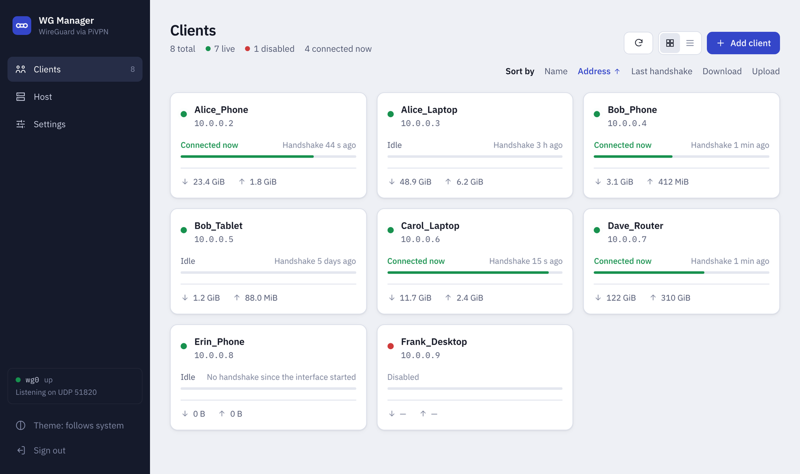

# WG Manager

A web page for managing the clients of a [PiVPN](https://pivpn.io) WireGuard server. From a browser you can add, enable, disable and delete clients, show a client's QR code, download its config file, and see who is connected.

<picture>
  <source media="(prefers-color-scheme: dark)" srcset="docs/screenshot-dark.png">
  
</picture>

WG Manager has three parts:

- **The web app** runs in Docker. It is the page you open in your browser.
- **A small helper** is installed on your server. It is the only part that touches WireGuard, and it does so by running PiVPN's own tools.
- **An SSH key** connects the two. It can start the helper and nothing else.

PiVPN stays in charge of your server, and the `pivpn` command keeps working alongside WG Manager. [How it works](#how-it-works) has the details.

> [!TIP]
> **[Try the live demo](https://wgmanager-demo.pages.dev).** It runs entirely in your browser with sample data, and any password signs you in.


# Documentation

**Jump to:** [Before you begin](#before-you-begin) · [Install](#install) · [Using WG Manager](#using-wg-manager) · [Update](#update) · [Troubleshooting](#troubleshooting) · [Uninstall](#uninstall) · [Configuration reference](#configuration-reference)


## Before you begin

### What you need

- A 64-bit server (amd64 or arm64) running Debian or a Debian-based system, such as Raspberry Pi OS (64-bit). WG Manager is tested on Debian 13; see [Tested with](#tested-with).
- [PiVPN](https://pivpn.io) already set up with **WireGuard** (not OpenVPN).
- Docker with Compose v2. Check with `docker compose version`.
- `python3`, `sudo` and an OpenSSH server (the service that lets you log in over SSH). Most Debian servers already have all three.

WG Manager must run on **the same machine as PiVPN**, not on a separate computer.

### Where to run each command

Run every command in this guide in a terminal **on the PiVPN server** (for example, over SSH), unless a step says otherwise. Steps that happen in a web browser can be done from any device on your network.

Depending on how Docker is set up on your server, `docker` commands may need `sudo` in front of them. If one fails with "permission denied", run it again with `sudo`.

### Look up two things

You will need these during the install:

- **Your server's address:** the address or name you use to log in to it over SSH, for example `192.168.1.10` or `myserver.local`. In this guide it is written `<server-address>`.
- **Your SSH port:** `22` unless you changed it. To check, run `sudo sshd -T | grep -i '^port '`. It prints a line such as `port 22`.

> [!WARNING]
> Don't install, update or restart WG Manager while you are connected to the server through the VPN it manages. If something goes wrong, you lose the connection you are using. Connect from your local network, or use the server's own keyboard and screen, instead.

---

## Install

### Step 1. Download the two setup files

Create a folder for WG Manager and put two files in it:

- `compose.yaml` tells Docker how to run the app.
- `.env` holds your settings.

Any folder works. If you use a container manager such as Arcane, create the folder where it looks for projects.

```sh
mkdir -p ~/wgmanager && cd ~/wgmanager
curl -fsSLO https://raw.githubusercontent.com/elmedico27/wgmanager/master/compose.yaml
curl -fsSLO https://raw.githubusercontent.com/elmedico27/wgmanager/master/.env.example
mv .env.example .env
```

If you'd rather not use `curl`, create both files yourself and paste in the contents of [compose.yaml](compose.yaml) and [.env.example](.env.example).

The settings file must be named exactly **`.env`**, not `.env.example`, or Docker Compose ignores it. File names that start with a dot are hidden by default; `ls -a` shows them.

### Step 2. Check your settings

Open `.env` in any text editor (for example `nano .env`). Every setting is optional. The one you are most likely to change:

- If your SSH port is not `22`, set `SSH_PORT` to your port.

Leave the rest as it is unless you have a reason to change it. Every setting is explained in the [Configuration reference](#configuration-reference).

### Step 3. Start WG Manager and find the setup code

In the same folder, run:

```sh
docker compose up -d
docker logs wgmanager
```

The first command downloads and starts the app, which can take a minute. The second shows its log, which contains a one-time **setup code** in a box like this (your code will differ):

```
============================================================
 wgmanager has no admin password yet.
 Setup code: 7H2K-QX9M-4TDB
 Open the web UI and enter this code to choose the password.
============================================================
```

If you miss it, run `docker logs wgmanager` again. A container manager's log view (Arcane, Portainer and others) shows it too.

### Step 4. Choose your admin password

In a browser, open `http://<server-address>:7501`. If you changed `WEB_PORT`, use that port instead of `7501`.

1. Enter the **Setup code**. Capital letters and dashes don't matter.
2. Enter a **New password** of at least 12 characters, then repeat it under **Confirm password**.
3. Click **Save password and continue**.

From now on you sign in with this password only. There is no username.

### Step 5. Install the helper on the server

The next screen is titled **Connect WG Manager to your server**. Under **Install the helper on the server** is a command with this app's SSH key already filled in. Click **Copy**, then paste and run it in a terminal on the server. It looks like this:

```sh
sudo docker cp wgmanager:/opt/wgmanager/host/. /usr/local/lib/wgmanager && \
  sudo python3 /usr/local/lib/wgmanager/wgmanager-host install --pubkey "ssh-ed25519 AAAA... wgmanager@container"
```

> [!IMPORTANT]
> The `ssh-ed25519 AAAA...` above is only a placeholder. Copy the command from the screen so that it contains your app's real key.

The command does two things:

1. It copies the helper's files out of the container into `/usr/local/lib/wgmanager`. Keep the `sudo`: the files must end up owned by root.
2. It runs the installer. The installer first prints a plan of every change and asks `Proceed? [y/N]`. Nothing has changed yet. Type `y` and press Enter to go ahead; anything else cancels.

Good to know:

- To see the plan without installing, add `--dry-run` to the end of the command. To skip the question, add `--yes`.
- If the server already has a different WG Manager key installed (for example, after you reinstalled the app from scratch), add `--replace-key` to the end of the command.
- [What the installer changes on the server](#what-the-installer-changes-on-the-server) lists every file it touches.

When it finishes, the installer runs its checks and ends with a line like this, which you need in the next step:

```
Server fingerprint for the web UI: SHA256:7Zk3mQ1vYy0b8t5nJd2RwXl9pUcA4eHs6GfTiVoNqMw (ED25519)
```

### Step 6. Confirm that this is your server

Back in the browser, click **Test connection**. WG Manager contacts the server and shows **Confirm this is your server**, with the fingerprint the server presented.

1. Compare it with the fingerprint on the installer's last line. If you no longer have that output, run `ssh-keygen -lf /etc/ssh/ssh_host_ed25519_key.pub` on the server and compare against its output.
2. If they are the same, click **It matches**.
3. If they differ, click **It doesn't match** and stop. See [The fingerprints don't match](#the-fingerprints-dont-match).

WG Manager remembers this fingerprint. From then on it refuses to talk to anything that presents a different one, so nothing can pose as your server.

Your clients now appear. The install is finished.

---

## Using WG Manager

The sidebar (a bar along the bottom on phones) has three pages: **Clients**, **Host** and **Settings**. At its bottom are a theme button (follow your device, light or dark) and **Sign out**.

### Clients

This page lists your VPN clients as cards or as a list; switch between them with the buttons at the top. It refreshes itself every 15 seconds while the tab is visible.

- **Add a client:** click **Add client**, enter a name and confirm. The new client's QR code and config download appear straight away. Scan the QR code with the WireGuard app on a phone, or download the config file for a computer.
- **Open a client:** click it. A panel slides in with its QR code and config (each behind a click, because they contain the client's private key), a download button, its details, and **Manage** buttons to disable, enable or delete it. Disabling and deleting ask you to confirm.
- **Sort:** click a column heading in list view, or use **Sort by** above the cards. Click again to reverse. Your browser remembers your choice.

**Client names** can use letters, digits, `_` and `-`, up to 15 characters. A name can't be all digits, can't be `server`, and must be unique (`Alice` and `alice` count as the same name). Use one client per device, for example `Alice_Phone`.

**What the details mean:**

| Item | Meaning |
|---|---|
| Status dot | **Green:** enabled and active on the server's WireGuard interface. **Red:** disabled. **Yellow:** something doesn't line up, for example enabled but not active. Open the client to see why; **Enable again** can fix it. |
| Connected now | The device completed a *handshake* (the brief exchange WireGuard uses to set up a secure link) in the last 3 minutes. WireGuard has no real "connected" state, and an idle device sends nothing, so a connected but idle device can look disconnected. |
| Last handshake | When that exchange last happened. |
| Last seen from | The device's public internet address at its last handshake. It is not your server's address. |
| Downloaded / Uploaded | Data transferred, counted from the device's point of view, since the WireGuard interface last started. |
| Address | The client's address inside the VPN. |

Some clients are shown greyed out with a reason and no buttons. These are clients whose name breaks the rules above, or whose address is outside the VPN's range. Manage them with `pivpn` on the server.

If the WireGuard interface is down, **Add client** and **Enable** are switched off, because a change couldn't take effect. See [The WireGuard interface is down](#the-wireguard-interface-is-down).

### Host

Shows the state of the server side: the WireGuard interface (name, port, public key, number of clients), the helper (version, protocol, backend and the address it was reached at) and the PiVPN scripts it runs, with a SHA-256 hash of each. Warnings from the server appear here too.

### Settings

- **Appearance:** follow your device, light or dark.
- **Admin password:** change it by entering the current one and a new one. This signs out every other browser.
- **SSH connection:** shows the server address, port and account WG Manager uses. These can't be changed here; edit `.env` instead (see [Configuration reference](#configuration-reference)).
- **Server identity:** the pinned fingerprint. Use **Confirm a new server identity…** only after you have deliberately replaced the server's SSH keys.
- **App key:** the app's public SSH key and the install command, used when you [update](#update) the helper.

### Page links

Each page has its own address, so you can bookmark it: `/clients`, `/host` and `/settings`. A client's panel has one too: `/clients/<name>`. Your browser's Back and Forward buttons work as expected.

---

## Update

Update the app first, then the helper. Both steps are safe to repeat. Read the [warning](#before-you-begin) about the VPN connection first.

1. **Update the app.** The helper files come from the app, so this goes first. In the folder that contains `compose.yaml`, run:

   ```sh
   docker compose pull && docker compose up -d
   ```

   Your password, SSH key and confirmed server identity are kept, so you don't need a new setup code. If you set `WGM_VERSION` in `.env` to a fixed version, change it to the new one first.

2. **Update the helper.** Sign in, open **Settings › App key**, copy the install command and run it on the server, exactly as in [Step 5](#step-5-install-the-helper-on-the-server). It changes only what differs. The app and the helper are released together, so do this after every app update.

---

## Troubleshooting

Start with [the doctor](#run-the-doctor): it finds most server-side problems and prints the command that fixes each one.

### Run the doctor

`doctor` is a read-only check of everything the helper needs. It changes nothing.

```sh
sudo python3 /usr/local/lib/wgmanager/wgmanager-host doctor
```

### "Nothing answered on SSH"

WG Manager couldn't reach your server's SSH service. Check, in order:

1. The server is on and `sshd` is running.
2. `SSH_HOST` and `SSH_PORT` in `.env` are right. After a change, run `docker compose up -d` in the app's folder.
3. `sshd` accepts connections on the app network's gateway address, `172.29.88.1`. The default setting (listen on all addresses) does. If you set `ListenAddress` yourself, add that address.
4. A firewall on the server allows SSH from `172.29.88.0/29`, the app's network.

Then click **Test connection** again.

### "The server answered but does not accept this app's key yet"

The helper isn't installed yet, or was installed with a different key. Run the install command from the screen (see [Step 5](#step-5-install-the-helper-on-the-server)), then test again.

### The fingerprints don't match

Don't continue. The server answering at `SSH_HOST` and `SSH_PORT` isn't presenting the fingerprint you expect.

1. Check that `SSH_HOST` and `SSH_PORT` in `.env` point at your WireGuard server, and fix them if not. Then run `docker compose up -d` and click **Check again**.
2. If they are right and the fingerprints still differ, something else may be answering in your server's place. Find out what before going on.

The same applies if WG Manager later reports that the **server identity changed**. It sends nothing to the server until you decide. If you know why (you reinstalled the server or replaced its SSH keys), go to **Settings › Server identity › Confirm a new server identity…** and confirm the new fingerprint. If you don't know why, investigate first.

### The app's network clashes with another network

The app runs on its own small Docker network, `172.29.88.0/29` (addresses `172.29.88.0` to `172.29.88.7`), chosen because it is unlikely to be in use. If it overlaps with a network you already have, `docker compose up -d` fails with an error saying the address pool overlaps (Docker's wording is "Pool overlaps with other one on this address space"). It also must not overlap the range your VPN clients use.
<!-- unverified: Docker's error wording above has not been seen on a real host. The `docker network inspect` command below was run on a real server (2026-10-25) and prints one `name: range` line per network. -->

To check and fix it:

1. **List your Docker networks and their ranges:**

   ```sh
   docker network ls -q | xargs docker network inspect --format '{{.Name}}: {{range .IPAM.Config}}{{.Subnet}} {{end}}'
   ```

   Each line is a network's name and its range, for example `bridge: 172.17.0.0/16`. Networks named `host` and `none` have no range; ignore them.

2. **Find your VPN's range.** Your clients' addresses on the **Clients** page show it (for example, `10.6.0.x`). PiVPN also stores it in `/etc/pivpn/wireguard/setupVars.conf` as `pivpnNET`.
3. **If any range overlaps `172.29.88.0/29`, choose another** unused private range of the same size, such as `192.168.250.0/29`. Write it as the network address (ending in `.0`), not the first usable address. Its gateway is the first usable address, `192.168.250.1`.
4. **Edit `compose.yaml`:** change `subnet` and `gateway` under `networks:` to your new values.
5. **Edit `.env`:** set `SSH_HOST` to the new gateway address.
6. **Recreate the app:** `docker compose up -d`.
7. **Update the server's allowed addresses.** Run the install command from **Settings › App key** again, with `--allow-from` added to the end:

   ```sh
   --allow-from 127.0.0.1,::1,192.168.250.0/29
   ```

   This list *replaces* the default, so keep `127.0.0.1,::1` in it. Reinstalling the same key with a different `--allow-from` doesn't need `--replace-key`.
8. Make sure the firewall rule and `sshd`'s `ListenAddress` (see "Nothing answered on SSH" above) use the new gateway and range.

### The WireGuard interface is down

WG Manager shows a banner saying no client can connect, and switches off **Add client** and **Enable**. The banner shows the exact command to start the interface on the server. With the usual interface name, `wg0`, it is:

```sh
sudo systemctl start wg-quick@wg0
```

### A change failed

Before every change, the helper backs up the server's config. If a change fails or only partly happens, WG Manager shows a warning on every page until you acknowledge it. It does not undo changes automatically. [docs/RECOVERY.md](docs/RECOVERY.md) explains how to check what happened and restore from the backup.

### I forgot the admin password

Run this on the server:

```sh
docker exec wgmanager wgmanager reset-password
```

It removes the password, signs everyone out, and prints a new **setup code** right in your terminal. Open the web page, enter the code and choose a new password.

---

## Uninstall

Your WireGuard server, PiVPN and all clients are left exactly as they are.

1. **Remove the helper from the server:**

   ```sh
   sudo python3 /usr/local/lib/wgmanager/wgmanager-host uninstall
   sudo rm -rf /usr/local/lib/wgmanager
   ```

   The first command removes what the installer added, including the `wgweb` account, but keeps the config backups in `/var/backups/wgmanager`. Add `--purge` to delete the backups and the optional settings file (`/etc/wgmanager/config`) too. The second command deletes the copy of the installer tool.

2. **Remove the app.** In the folder that contains `compose.yaml`:

   ```sh
   docker compose down -v
   ```

   The `-v` also deletes the app's data: the admin password, the SSH key and the confirmed server identity. Leave it out to keep that data for a later reinstall.

You can then delete the folder you made in Step 1.

---

## Configuration reference

Settings live in the `.env` file next to `compose.yaml`. All are optional. After changing one, run `docker compose up -d` in that folder to apply it. (The **Settings** page in the app shows the SSH values in use but can't change them.)

| Setting | Default | What it does | Change it when |
|---|---|---|---|
| `WEB_PORT` | `7501` | The port you type in your browser to open WG Manager. | Another program already uses 7501. |
| `WEB_BIND` | `0.0.0.0` | Which of the server's network addresses the web page is available on. `0.0.0.0` means all of them. A single address such as `192.168.1.10` limits it to that one; `127.0.0.1` allows only the server itself. | You want to restrict who can reach the page, for example behind a reverse proxy. |
| `SSH_HOST` | `172.29.88.1` | The address WG Manager uses to reach your server's SSH service. The default is the server itself, as seen from inside the container. | You changed the app's network (see [clash](#the-apps-network-clashes-with-another-network)). |
| `SSH_PORT` | `22` | The port your server's SSH service listens on. | Your SSH port isn't 22. |
| `SSH_USER` | `wgweb` | The account the installer creates for WG Manager. | Almost never. |
| `TRUST_PROXY` | `0` | Set to `1` only if an HTTPS reverse proxy sits in front of WG Manager. It then marks sign-in cookies as secure and trusts the proxy's `X-Forwarded-*` headers. | You put WG Manager behind a reverse proxy that serves HTTPS. |
| `WGM_VERSION` | `latest` | Which version of the app to run: `latest` (the newest release), `edge` (the newest, less tested, commit) or a fixed version such as `0.1.0`. | You want to stay on a specific version. |

**Where the image comes from:** each release is published to two registries with identical tags: GitHub Container Registry (`ghcr.io/elmedico27/wgmanager`, the default in `compose.yaml`) and [Docker Hub](https://hub.docker.com/r/elmedico27/wgmanager) (`elmedico27/wgmanager`). To pull from Docker Hub instead, change the `image:` line in `compose.yaml` to `elmedico27/wgmanager:${WGM_VERSION:-latest}`.

**Behind a reverse proxy:** set `TRUST_PROXY=1`, and consider `WEB_BIND=127.0.0.1` so the page can be reached only through the proxy. Plain HTTP on your own network works too.

---

## How it works

```
browser ──HTTP──▶ WG Manager (Docker) ──SSH──▶ sshd ──▶ wgmanager-helper (root) ──▶ pivpn / wg
                                         as user wgweb, forced command
```

- **The web app** (Node, in Docker) serves the page. It stores your admin password hash, its own SSH key and the server's confirmed fingerprint in its data volume. It never touches WireGuard itself.
- **The helper** (`/usr/local/sbin/wgmanager-helper`, one Python file using only the standard library) can do seven fixed things: list clients, add, remove, enable, disable, get a client's config, and report its version. For changes it runs PiVPN's own scripts. It backs up `wg0.conf` and `clients.txt` before each change, then checks that the change really happened, because PiVPN sometimes reports success when it failed. Its full contract is in [docs/HELPER-SPEC.md](docs/HELPER-SPEC.md).
- **The SSH key** belongs to the app. The container creates it on first start, and the private half never leaves the data volume; the installer only ever sees the public half. On the server, the key can connect only from the app's network, only as `wgweb`, and can only run the helper: no shell, no terminal, no forwarding.
- **The server's identity is pinned.** You confirm the server's SSH fingerprint once (Step 6). After that, WG Manager refuses to talk to a server that presents a different key, and says why.
- **One SSH connection is reused** for up to 5 minutes, so an open browser tab doesn't fill the server's log with logins.

### What the installer changes on the server

| Path | Purpose |
|---|---|
| `/usr/local/sbin/wgmanager-helper` | The helper, owned by root. |
| `wgweb` system account | Runs the helper over SSH. No home folder and no password login. |
| `/etc/sudoers.d/wgmanager` | Lets `wgweb` run the helper and nothing else. |
| `/etc/ssh/sshd_config.d/wgmanager.conf` | For `wgweb` only: key login, no terminal, no forwarding, and a forced command. |
| `/etc/wgmanager/authorized_keys` | The app's public key, limited to running the helper and to the allowed source addresses. |
| `/var/backups/wgmanager` | Config backups, created at the first change. The newest 20 are kept. |
| `/etc/wgmanager/config` | Optional helper settings. Never created for you; see [config.example](host/etc/wgmanager/config.example). |
| `/usr/local/lib/wgmanager` | The installer tool copied out of the container. Kept for `doctor`, updates and `uninstall`. |

The installer adds its own files only and never edits yours. When something that isn't its own is in the way, it stops and tells you the exact fix instead of changing it. Examples: PiVPN files that non-root users can write to, an existing `wgweb` account in a privileged group, an `sshd_config` that doesn't include `sshd_config.d`, or `AllowUsers`/`AllowGroups` rules that would lock `wgweb` out. It changes `sshd` last and undoes its own steps if one fails.

**About sshd.** The app accepts only the server's ED25519 host key, which Debian creates by default; `doctor` warns if it is missing. On Ubuntu 22.10 and later, `sshd` is started on demand and only runs after the first connection, so connect over SSH once before installing. There, the port and listen addresses come from `ssh.socket`, not `sshd_config`.

### Security notes

- The container runs as a non-root user with a read-only filesystem, no Linux capabilities and `no-new-privileges`. Only its data volume is writable.
- The admin password is stored as a scrypt hash in the data volume. Sign-in, setup and password changes are rate limited. Sessions live in memory (a restart signs everyone out), end after 6 hours idle or 7 days in total, and are protected against cross-site requests.
- Client configs and QR codes contain the client's private key. QR codes are made on request. Neither is cached by the browser or written to the app's log.
- There is no automatic rollback. If a change fails partway, WG Manager says so and leaves the backups for you to check. See [docs/RECOVERY.md](docs/RECOVERY.md).

### Tested with

Debian 13 (trixie), PiVPN's WireGuard scripts v4.6.2 (v4.7.0 ships the same ones), wireguard-tools v1.0.20210914, OpenSSH 10.0p2, sudo 1.9.16p2, Python 3.13 and Docker Compose v2. The current PiVPN (v4.11.1) differs only in `makeCONF.sh`. The helper's use of it was checked against that script's source but hasn't been run.

---

## Development

- `web/`: the Svelte UI. `npm run dev` runs it against a built-in mock of the helper.
- `server/`: the Node backend (built-in modules plus one QR library).
- `host/`: the helper and `wgmanager-host`. See [host/README.md](host/README.md).
- To build the image from a checkout: `docker compose -f compose.yaml -f compose.build.yaml up -d --build`.
- Tests: `python3 -m unittest discover -s host/tests` and, in `server/`, `npm test`. The SSH tests need a throwaway `sshd`; see `server/test/ssh-lab.sh` and `.github/workflows/build.yml`.

## Credits

WG Manager started as a fork of [pivpn-web](https://github.com/WeeJeWel/pivpn-web) by Emile Nijssen, whose author now recommends [wg-easy](https://github.com/wg-easy/wg-easy). It has since been rewritten: the UI, backend, helper and installer are new.

## License

[GPL-3.0](LICENSE)
